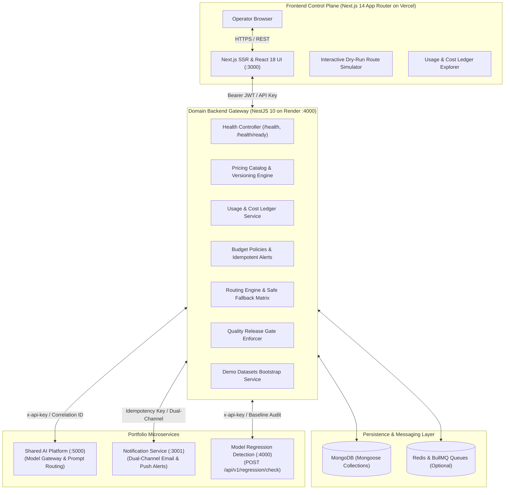

# 🧭 LLM Cost & Routing Autopilot

[](https://www.typescriptlang.org/)
[](https://nextjs.org/)
[](https://nestjs.com/)
[](https://mongoosejs.com/)
[](https://vercel.com/)
[](https://render.com/)

> **Tagline**: *Control LLM spend without losing sight of quality, latency, or reliability.*  
> **Description**: Enterprise-grade LLM cost analytics and intelligent routing system for budgets, token usage, latency-aware model selection, quota enforcement, and resilient provider fallback.

---

## 📑 Table of Contents

1. [Problem Statement & Overview](#-problem-statement--overview)
2. [System Architecture (HLD)](#-system-architecture-hld)
3. [Core Capabilities & Engineering Design](#-core-capabilities--engineering-design)
4. [Portfolio Microservice Ecosystem Integration](#-portfolio-microservice-ecosystem-integration)
5. [Quality-Aware Release Gates & Fail-Closed Enforcement](#-quality-aware-release-gates--fail-closed-enforcement)
6. [Frontend Control Plane Pages](#-frontend-control-plane-pages)
7. [Database Schemas & Indexing Strategy](#-database-schemas--indexing-strategy)
8. [REST API Specification](#-rest-api-specification)
9. [Independent Builds & Deployment Guide](#-independent-builds--deployment-guide)
10. [Local Development & Verification](#-local-development--verification)

---

## 🌟 Problem Statement & Overview

AI application owners frequently face fragmented visibility across their portfolio:
- **Blind Spend Inflation**: Lack of granular visibility into which application features consume tokens and driving costs up.
- **Silent Degradation**: Switching from flagship models (e.g. GPT-4o, Claude 3.5 Sonnet) to lightweight models (e.g. GPT-4o-mini, Gemini 1.5 Flash) to save cost risks severe quality and accuracy regressions.
- **Latency Breaches**: Falling back to distant or unoptimized models causes user-facing SLAs to spike.
- **Provider Outages & Retry Storms**: Naive retry logic duplicates expensive side effects and storms rate-limited providers.

**LLM Cost & Routing Autopilot** provides a unified control-plane UI and modular backend API for observing usage, setting monthly/daily budget caps with hard-block protection, and defining intelligent routing policies with explainable candidate trees and safe fallback execution.

---

## 🏗️ System Architecture (HLD)



---

## ⚙️ Core Capabilities & Engineering Design

### 1. Usage and Cost Ledger
- **Attribution Fields**: Records `applicationId`, `tenantId`, `featureId`, `model`, `provider`, `requestTimestamp`, `latencyMs`, `promptTokens`, `completionTokens`, `estimatedCostUsd`, `status`, `correlationId`, and `measurementSource`.
- **Estimate vs Invoice Distinction**: Explicitly flags `costSource` (`ESTIMATED_CATALOG` vs `PROVIDER_REPORTED`). Estimates computed with configured pricing catalogs are never misrepresented as official provider invoice statements.
- **Versioned Pricing Catalog**: Stores effective-dated model pricing (e.g. `catalog-2026.04-v1`) stamped on every measurement for audit integrity.

### 2. Budget Policies & Quota Enforcement
- **Multi-Scope Caps**: Monthly, daily, and feature-level budgets with configurable warning thresholds (e.g. 80%) and hard limits.
- **Consumption Tracking**: Live calculation of consumed spend and percentage of budget used.
- **Idempotent Alert Notifications**: Budget alerts generate a deterministic idempotency key (`budget-{policyId}-{periodMonth}-{tier}`) preventing duplicate notifications to the shared Notification Service.
- **Explicit Hard Block vs Soft Alert**: Hard-block budgets immediately reject upstream model calls once 100% capacity is reached, while soft limits notify operators without interrupting user traffic.

### 3. Usage Analytics & Statistical Anomaly Detection
- **Time-Series Aggregation**: Multi-dimensional group-by queries across application, feature, model, provider, and tenant.
- **Statistical Outlier Detection (Z-Score)**: Evaluates a 14-day rolling baseline mean ($\mu$) and standard deviation ($\sigma$). Flags daily spikes where $Z = \frac{x - \mu}{\sigma} \ge 2.0$ (Warning) and $Z \ge 3.0$ (Critical) with explainability details.
- **Data Completeness**: Transparently reports whether figures are catalog estimates or verified provider billing exports.

### 4. Routing Policy Simulation & Dry-Run Engine
- **Constraint Matrix**: Evaluates candidate models against latency SLA targets, cost caps ($ / 1k tokens), provider allowlists, and baseline quality requirements.
- **Explainable Decision Tree**: Discloses exact reasons for route rejection (`EXCEEDS_LATENCY_TARGET`, `EXCEEDS_COST_LIMIT`, `PROVIDER_NOT_ALLOWED`, `QUALITY_GATE_FAILED`).
- **Ground Truth Integrity**: Never claims an unmeasured route is better, cheaper, or faster.

### 5. Safe Fallback Design
- **Error Classification**: Automatically handles model timeouts, 429 rate limits, and 503/504 provider outages.
- **Prohibited Fallbacks**: Explicitly **refuses** to fallback around authentication or authorization errors (401/403) to prevent credential bypass attacks.
- **Retry Budgets & Deduplication**: Bounded exponential backoff with jitter prevents retry storms and avoids duplicate side-effect execution.

### 6. Quality-Aware Release Gates
- **Model Regression Platform Integration**: Directly checks `ai-model-regression-detection` via `POST /api/v1/regression/check`.
- **Fail-Closed Operator Policy**: If the external regression detection platform is unreachable, hard quality gates **fail closed** to protect production users. Missing evaluation results are **never** silently treated as `PASS`.

### 7. Audit & Explainability
- **Trace Inspector**: Detailed audit records capturing correlation ID, candidate evaluations, rejection reasons, winning model, and sanitized parameters.
- **Tenant Isolation**: Query filters are strictly tenant-scoped in the repository and service layer.

---

## 🏢 Portfolio Microservice Ecosystem Integration

| Service | Protocol | Verified Contract & Semantics | Fallback / Resilience |
| :--- | :--- | :--- | :--- |
| **Shared AI Platform** (`:5000`) | REST / HTTP | `POST /v1/chat` with `{ applicationId, model, messages, maxTokens }` using `x-api-key` and `X-Correlation-ID`. | Timeout budget (10s), returns high-fidelity synthetic sandbox response if offline. |
| **Notification Service** (`:3001`) | REST / HTTP | `POST /v1/notifications` with `{ channels: ['email','push','slack'], recipient, template, parameters, idempotencyKey }`. | In-memory and database idempotency guards; handles unreachable service gracefully without breaking domain flow. |
| **Model Regression Detection** (`:4000`) | REST / HTTP | `POST /api/v1/regression/check` with `{ project, version, datasetId, model, provider, baselineId, metrics }`. | Strict `FAIL_CLOSED` policy enforcement; never silently passes missing evaluation results. |

---

## 🖥️ Frontend Control Plane Pages

1. **Overview (`/`)**: High-level spend KPI tiles, token volume, latency trends, active budget consumption gauges, time-series spend trajectory, and anomaly alerts.
2. **Usage Explorer (`/usage`)**: Searchable, filterable ledger of all token consumption records with slide-out event drawer detailing correlation ID, catalog version, and cost attribution.
3. **Budget Policies (`/budgets`)**: Monthly, daily, and feature-scoped budgets with progress meters, soft warning vs hard block toggles, and idempotent notification logs.
4. **Routing Policies (`/routing`)**: Policy configuration matrix, provider allowlists, model priority sequences, and fallback rescue chains.
5. **Route Simulator (`/simulator`)**: Interactive playground testing scenarios against active policies, displaying candidate evaluation trees and winning rationale.
6. **Quality Gates (`/quality-gates`)**: Real-time integration check with Model Regression Detection platform, displaying metric deltas, baseline scores, and fail-closed gate status.
7. **Incidents & Audit (`/incidents`)**: Statistical spend outliers (Z-score spikes), fallback activation history, and redacted decision audit trails.
8. **Settings (`/settings`)**: Effective-dated model pricing catalog viewer, microservice integration health check status, and application configuration.

---

## 🗄️ Database Schemas & Indexing Strategy

- **`pricing_catalogs`**:
  - `catalogVersion` (unique), `effectiveFrom`, `effectiveTo`, `currency`, `isCurrent`, `models[]`.
  - Indexes: `{ effectiveFrom: 1, effectiveTo: 1 }`.
- **`usage_events`**:
  - `eventId` (unique), `correlationId`, `tenantId`, `applicationId`, `featureId`, `model`, `provider`, `requestTimestamp`, `latencyMs`, `promptTokens`, `completionTokens`, `totalTokens`, `estimatedCostUsd`, `providerReportedCostUsd`, `costSource`, `pricingCatalogVersion`, `status`, `fallbackActivated`.
  - Indexes: `{ tenantId: 1, requestTimestamp: -1 }`, `{ tenantId: 1, applicationId: 1, featureId: 1 }`, `{ tenantId: 1, model: 1, status: 1 }`.
- **`budget_policies`**:
  - `policyId` (unique), `name`, `tenantId`, `applicationId`, `featureId`, `period`, `limitUsd`, `warnThresholdPercent`, `hardBlockEnabled`, `currentSpendUsd`, `status`.
  - Indexes: `{ tenantId: 1, applicationId: 1 }`, `{ tenantId: 1, status: 1 }`.
- **`budget_alerts`**:
  - `alertId` (unique), `policyId`, `tenantId`, `alertType`, `idempotencyKey` (unique), `notificationStatus`, `message`.
  - Indexes: `{ tenantId: 1, createdAt: -1 }`, `{ policyId: 1, createdAt: -1 }`.
- **`routing_policies`**:
  - `policyId` (unique), `name`, `tenantId`, `applicationId`, `latencyTargetMs`, `maxCostPer1kTokensUsd`, `qualityThreshold`, `providerAllowlist`, `modelPriority`, `fallbackOrder`, `qualityGateMode`, `active`.
  - Indexes: `{ tenantId: 1, applicationId: 1, active: 1 }`.
- **`decision_audits`**:
  - `auditId` (unique), `correlationId`, `tenantId`, `applicationId`, `candidateEvaluations[]`, `selectedRoute`, `fallbackChain[]`, `redacted`.
  - Indexes: `{ tenantId: 1, createdAt: -1 }`, `{ applicationId: 1, featureId: 1 }`.

---

## 🔌 REST API Specification

### Health Probes
- `GET /health`: Liveness probe (`{ status: 'ok', uptime, timestamp }`).
- `GET /health/ready`: Readiness probe verifying MongoDB, Redis, AI Platform, Notification Service, and Model Regression Service.

### Pricing Engine
- `GET /api/v1/pricing/current`: Get active model pricing catalog.
- `GET /api/v1/pricing/versions`: List effective-dated catalog versions.
- `POST /api/v1/pricing/calculate`: Compute estimated cost for prompt & completion token volumes.

### Usage & Ledger
- `POST /api/v1/usage/ingest`: Record raw usage measurement event (idempotent).
- `GET /api/v1/usage/ledger`: Query filterable ledger events.
- `GET /api/v1/usage/analytics`: Get aggregated KPIs, breakdowns, and time-series data.
- `GET /api/v1/usage/anomalies`: Run statistical Z-score spend anomaly analysis.

### Budgets
- `GET /api/v1/budgets`: List budget policies for tenant.
- `POST /api/v1/budgets`: Create a new budget policy.
- `GET /api/v1/budgets/alerts`: List historical budget alerts.
- `PUT /api/v1/budgets/:id`: Update budget limits and thresholds.

### Routing & Simulation
- `GET /api/v1/routing/policies`: List active routing rules.
- `POST /api/v1/routing/simulation`: Dry-run simulation of candidate models.
- `POST /api/v1/routing/execute`: Invoke selected route with automatic safe fallback.
- `GET /api/v1/routing/audits`: Query decision audit traces.

### Quality Gates
- `POST /api/v1/quality-gates/evaluate`: Evaluate candidate model against Model Regression Detection platform.

### Seed & Demo
- `POST /api/v1/seed`: Bootstrap realistic production demo datasets.

---

## 🚀 Independent Builds & Deployment Guide

The frontend and backend are completely independent and deployed to separate hosting platforms:
- **Frontend**: Next.js App Router deployed to **Vercel**.
- **Backend**: NestJS REST API deployed to **Render**.

```
ai-cost-routing-autopilot/
├── frontend/               # Next.js Application (Vercel)
│   ├── package.json        # Frontend-only build & dependencies
│   ├── vercel.json         # Vercel configuration
│   └── src/app/            # App Router pages
├── backend/                # NestJS Application (Render)
│   ├── package.json        # Backend-only build & dependencies
│   └── src/                # NestJS modules, schemas & controllers
├── render.yaml             # Render Blueprint specification
├── .vercelignore           # Excludes backend/ from frontend builds
└── package.json            # Local full-stack verification scripts
```

### 1. Render Deployment (Backend Web Service)

1. Create a new **Web Service** in [Render](https://render.com/).
2. Select your repository: `ai-cost-routing-autopilot`.
3. Configure service settings:
   - **Root Directory**: `backend`
   - **Environment**: `Node`
   - **Build Command**: `npm install && npm run build`
   - **Start Command**: `npm run start:prod`
   - **Health Check Path**: `/health`
4. Set **Build Filter**:
   - In Render Web Service settings &rarr; **Build & Deploy** &rarr; **Build Filters**:
   - Set path filter to: `backend/**`
   - *Result*: Frontend-only commits (`frontend/**`) will **never** trigger an unnecessary backend build.
5. Configure Environment Variables in Render:
   ```env
   NODE_ENV=production
   PORT=4000
   PUBLIC_ACCESS_ENABLED=true
   FRONTEND_URL=https://ai-cost-routing-autopilot.vercel.app
   MONGODB_URI=mongodb+srv://...
   REDIS_URL=redis://...
   JWT_ACCESS_SECRET=<secure-random-secret>
   JWT_REFRESH_SECRET=<secure-random-secret>
   AI_PLATFORM_URL=https://ai-platform.onrender.com
   AI_PLATFORM_API_KEY=<ai-platform-secret>
   NOTIFICATION_SERVICE_URL=https://notification-service.onrender.com
   NOTIFICATION_SERVICE_API_KEY=<notification-service-secret>
   MODEL_REGRESSION_SERVICE_URL=https://ai-model-regression-detection.onrender.com
   MODEL_REGRESSION_SERVICE_API_KEY=<regression-service-secret>
   ```

### 2. Vercel Deployment (Frontend Project)

1. Import your repository in [Vercel](https://vercel.com/).
2. Set Project Settings:
   - **Framework Preset**: `Next.js`
   - **Root Directory**: `frontend`
   - **Build Command**: `npm run build`
   - **Output Directory**: Next.js Default (`.next`)
   - **Install Command**: `npm install`
3. Configure **Ignored Build Step**:
   - In Vercel &rarr; **Settings** &rarr; **Git** &rarr; **Ignored Build Step**:
   - Set behavior to run only when `frontend` changes:
     ```bash
     git diff --quiet HEAD^ HEAD .
     ```
   - *Result*: Backend-only commits (`backend/**`) will **never** trigger a Vercel frontend rebuild.
4. Set Environment Variables in Vercel:
   ```env
   NEXT_PUBLIC_API_URL=https://ai-cost-routing-autopilot.onrender.com/api/v1
   NEXT_PUBLIC_ACCESS_ENABLED=true
   NEXT_PUBLIC_APP_URL=https://ai-cost-routing-autopilot.vercel.app
   ```
   > **Note on Public Variables**: Next.js embeds `NEXT_PUBLIC_*` values into the client bundle at build time. Changing `NEXT_PUBLIC_API_URL` requires triggering a new frontend production build in Vercel.

---

## 🛠️ Local Development & Verification

### Running Applications Independently

```bash
# 1. Backend Development (:4000)
cd backend
npm install
npm run start:dev

# 2. Frontend Development (:3000)
cd frontend
npm install
npm run dev
```

### Validating Independent Production Builds

```bash
# Verify Backend NestJS Build:
cd backend
npm test
npm run build

# Verify Frontend Next.js Build:
cd frontend
npm test
npm run build
```

### Full-Stack Verification (Repository Root)

```bash
# Run tests across both applications:
npm test

# Run linting across both applications:
npm run lint

# Compile production builds for both applications:
npm run build
```

---

## 👤 Author & Portfolio References

**Rishank Kesarwani**  
Senior AI & Full-Stack Engineer  
- GitHub: [@rishank-kesarwani](https://github.com/rishank-kesarwani)
- Portfolio Systems:
  - [`ai-model-regression-detection`](https://github.com/rishank-kesarwani/ai-model-regression-detection)
  - [`ai-movie-matcher`](https://github.com/rishank-kesarwani/ai-movie-matcher)
  - [`ai-platform`](https://github.com/rishank-kesarwani/ai-platform)
  - [`notification-service`](https://github.com/rishank-kesarwani/notification-service)
  - [`ai-travel-planner`](https://github.com/rishank-kesarwani/ai-travel-planner)
